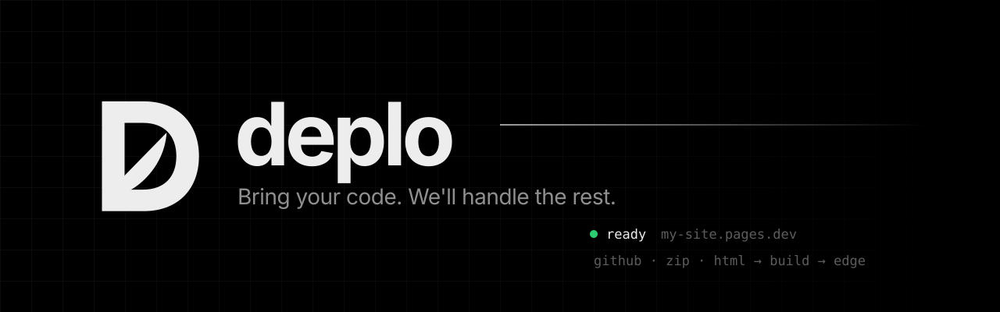
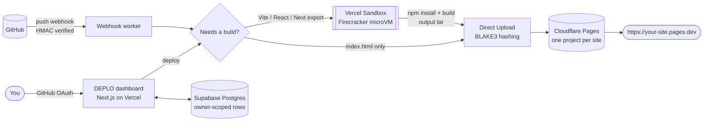

<div align="center">



<h3>Your own Vercel-style deploy platform. Open source, self-hostable, free to run.</h3>

<p>
  Import a GitHub repo, upload a ZIP, or drop in one HTML file.<br />
  DEPLO builds it in an isolated microVM and ships it to Cloudflare's edge with a live URL.
</p>

<p>
  <a href="https://github.com/ansh44233/DEPLO/stargazers"></a>
  <a href="https://github.com/ansh44233/DEPLO/network/members"></a>
  <a href="LICENSE"></a>
  <a href="https://github.com/ansh44233/DEPLO/actions/workflows/ci.yml"></a>
</p>

<p>
  
  
  
  
  
  
</p>

<p>
  <a href="https://deplo-sand.vercel.app"><b>Live demo</b></a> ·
  <a href="#-quick-start"><b>Quick start</b></a> ·
  <a href="#-features"><b>Features</b></a> ·
  <a href="#-architecture"><b>Architecture</b></a> ·
  <a href="docs/VERCEL.md"><b>Self-host on Vercel</b></a> ·
  <a href="docs/REFERENCE.md"><b>API reference</b></a>
</p>

<a href="https://vercel.com/new/clone?repository-url=https%3A%2F%2Fgithub.com%2Fansh44233%2FDEPLO&project-name=deplo&env=DEPLO_BASE_URL,DEPLO_SESSION_SECRET,GITHUB_CLIENT_ID,GITHUB_CLIENT_SECRET,GITHUB_TOKEN_ENCRYPTION_KEY,SUPABASE_URL,SUPABASE_SERVICE_ROLE_KEY,CLOUDFLARE_ACCOUNT_ID,CLOUDFLARE_API_TOKEN,CRON_SECRET&envDescription=See%20docs%2FVERCEL.md%20for%20what%20each%20value%20is&envLink=https%3A%2F%2Fgithub.com%2Fansh44233%2FDEPLO%2Fblob%2Fmain%2Fdocs%2FVERCEL.md"></a>

</div>

---

## ⚡ The 30-second pitch

```text
  you                         DEPLO                                   the internet
  ───                         ─────                                   ────────────
  git push  ───────────────▶  webhook ─▶ clone ─▶ npm install ─▶ build
  upload .zip ─────────────▶  safe extract ──────────────────────────┐
  drop index.html ─────────▶  validate ──────────────────────────────┤
                                                                     ▼
                              hash + upload only changed files ─▶ Cloudflare Pages ─▶ https://your-site.pages.dev
```

- **No servers to babysit.** DEPLO runs on Vercel's free tier. Sites are served by Cloudflare's global network.
- **Real builds, safely.** Vite, React, Create React App and static Next.js are built inside a throwaway **Vercel Sandbox** Firecracker microVM. Your code never runs next to DEPLO's secrets.
- **Every site is isolated.** Each project gets its own Cloudflare Pages project, so rollbacks, logs and domains never cross between users.

---

## ✨ Features

<table>
<tr>
<td width="50%" valign="top">

### 🚀 Ship
- **GitHub import**: pick from your repos (private too), any branch
- **Environment variables**: encrypted per project, paste a whole `.env`
- **ZIP and HTML upload**: built sites or raw Vite/React projects, up to 25 MB
- **Framework builds**: Vite · React · CRA · Next.js static export
- **Push to deploy**: GitHub App webhook redeploys on every push
- **Smart uploads**: BLAKE3 content hashing, unchanged files are skipped

</td>
<td width="50%" valign="top">

### 🧭 Operate
- **Live preview** of every deployed site, right on the dashboard
- **Deployment history** with commit, branch and status
- **Build logs** with errors highlighted, plus one-click copy
- **Instant rollback** to any earlier production deploy
- **Custom domains** with DNS records shown inline

</td>
</tr>
<tr>
<td width="50%" valign="top">

### 🛡️ Secure by default
- Signed, HttpOnly sessions; GitHub tokens encrypted with **AES-256-GCM**
- Zip-slip, symlink, archive-bomb and secret-file checks on every upload
- Builds in an isolated microVM with **no DEPLO credentials inside**
- Webhooks verified with HMAC-SHA256; workers behind bearer secrets
- Every database row scoped to its owner; RLS on, no public policies

</td>
<td width="50%" valign="top">

### ⌨️ Feels fast
- **`Ctrl K` command menu** for projects, tabs and actions
- Vercel-style dark UI with Geist, built mobile-first
- Toasts, skeleton loaders, keyboard focus and reduced-motion support
- Live deploy timer and clear, actionable error messages
- One honest status dot: is hosting connected or not

</td>
</tr>
</table>

---

## 🏁 Quick start

### Option A: one click on Vercel (recommended)

1. Press **Deploy with Vercel** above.
2. Fill in the environment variables (what each one is: [docs/VERCEL.md](docs/VERCEL.md#3-environment-variables-production)).
3. Run the SQL files in [`supabase/migrations/`](supabase/migrations) in order (0001 → 0015) on a new Supabase project.
4. Open your deployment, sign in with GitHub, and ship something.

### Option B: run it locally

```bash
git clone https://github.com/ansh44233/DEPLO.git
cd DEPLO
npm install
cp .env.example .env.local     # fill in your own values
npm run dev                     # http://localhost:3000
```

> [!NOTE]
> Plain HTML and ZIP sites deploy from anywhere. **Framework builds** (Vite, React, Next) use Vercel Sandbox, which works automatically when DEPLO runs on Vercel. Locally, set `VERCEL_TOKEN`, `VERCEL_TEAM_ID` and `VERCEL_PROJECT_ID` to enable it.

<details>
<summary><b>🔑 Environment variables</b> (click to expand)</summary>

| Variable | Required | What it's for |
| --- | :---: | --- |
| `DEPLO_BASE_URL` | ✅ | Public URL of your DEPLO, e.g. `https://deplo.example.com` |
| `DEPLO_SESSION_SECRET` | ✅ | Signs session cookies. 32+ random characters |
| `GITHUB_CLIENT_ID` / `GITHUB_CLIENT_SECRET` | ✅ | GitHub OAuth App for "Sign in with GitHub" |
| `GITHUB_TOKEN_ENCRYPTION_KEY` | ✅ | Encrypts the GitHub token cookie. 32+ characters |
| `SUPABASE_URL` / `SUPABASE_SERVICE_ROLE_KEY` | ✅ | Project storage. A `sb_secret_…` key works |
| `CLOUDFLARE_ACCOUNT_ID` / `CLOUDFLARE_API_TOKEN` | ✅ | Where sites are hosted. Token needs **Pages: Edit** |
| `CRON_SECRET` | ✅ on Vercel | Authenticates the daily backstop cron |
| `DEPLO_GITHUB_WEBHOOK_SECRET` | push deploys | Must match the GitHub App webhook secret |
| `DEPLO_WEBHOOK_WORKER_SECRET` | push deploys | Protects the webhook worker endpoint |
| `GITHUB_APP_ID` / `GITHUB_APP_SLUG` / `GITHUB_APP_PRIVATE_KEY` | private repos | GitHub App for unattended private access |
| `VERCEL_TOKEN` / `VERCEL_TEAM_ID` / `VERCEL_PROJECT_ID` | off-Vercel builds | Sandbox credentials when not running on Vercel |

Generate secrets with `openssl rand -base64 48`. Never prefix any of them with `NEXT_PUBLIC_`.

</details>

---

## 🏗️ Architecture



<details>
<summary><b>📂 What's inside</b></summary>

```text
DEPLO/
├── app/
│   ├── page.tsx                     # the dashboard: shared state, project actions, layout
│   └── api/
│       ├── auth/                    # GitHub OAuth, session, GitHub App install
│       ├── projects/[id]/           # deploy · upload · domains · builds · rollback · logs
│       ├── webhooks/github/         # signed push receiver
│       └── internal/                # queue workers (cron + after())
├── components/dashboard/            # one component per screen, tab and dialog
├── hooks/                           # one hook per feature (builds, domains, env vars, …)
├── lib/
│   ├── dashboard/               # dashboard types, formatting helpers, ⌘K menu logic
│   ├── deploy/
│   │   ├── sandbox-build.ts         # clone → install → build in Vercel Sandbox
│   │   ├── cloudflare-pages.ts      # Direct Upload API, no CLI
│   │   ├── blake3.ts                # pure-TS BLAKE3 for asset keys
│   │   └── tar-extract.ts           # safe build-output extraction
│   ├── auth/                        # sessions, token crypto, OAuth exchange
│   ├── uploads/                     # zip-slip & archive-bomb defenses
│   └── workers/                     # worker auth, self-kick, queue draining
├── services/build-runner/           # optional self-hosted Firecracker runner
├── supabase/migrations/             # 14 ordered SQL migrations
├── tests/                           # 270+ node:test cases
└── docs/                            # Vercel guide, API reference, security notes
```

</details>

---

## 🧪 Quality bar

```bash
npm test            # 270+ tests: crypto, uploads, BLAKE3 vectors, sandbox builds, workers
npm run typecheck   # strict TypeScript
npm run build       # production Next.js build
```

Every pull request runs migrations check, tests, typecheck and build in CI.

---

## 🗺️ Roadmap

- [x] GitHub, ZIP and HTML deploys to Cloudflare Pages
- [x] Push-to-deploy with a GitHub App
- [x] Framework builds in Vercel Sandbox
- [x] Rollbacks, logs, custom domains
- [x] Command menu and live site previews
- [x] Per-project environment variables for builds
- [x] Pick repositories from your GitHub account
- [x] Preview deployments for pull requests
- [ ] Streaming build logs while the build runs
- [ ] Team workspaces

---

## 🤝 Contributing

Issues and pull requests are welcome. Read [CONTRIBUTING.md](CONTRIBUTING.md), and report security problems privately as described in [SECURITY.md](SECURITY.md).

<div align="center">

**If DEPLO saved you a deploy, leave a ⭐. It genuinely helps.**

<a href="https://star-history.com/#ansh44233/DEPLO&Date">
  
</a>

<sub>MIT licensed · Built by <a href="https://github.com/ansh44233">@ansh44233</a> and contributors</sub>

</div>
